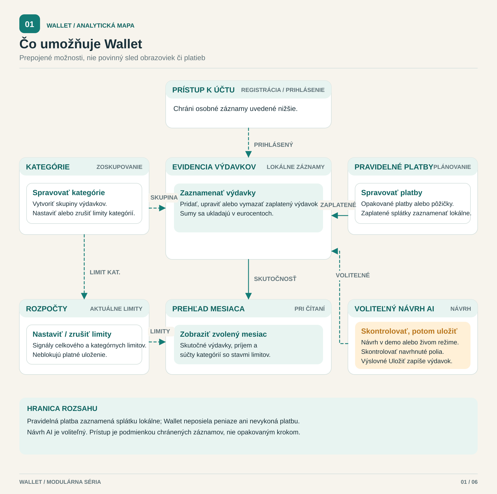
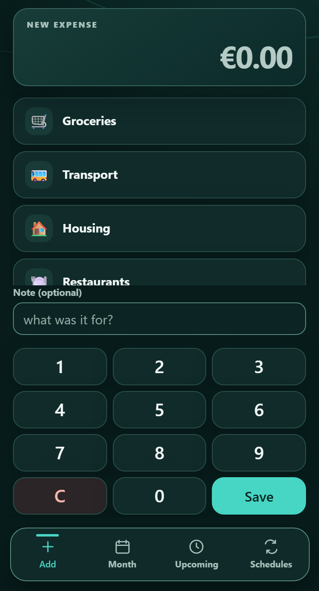
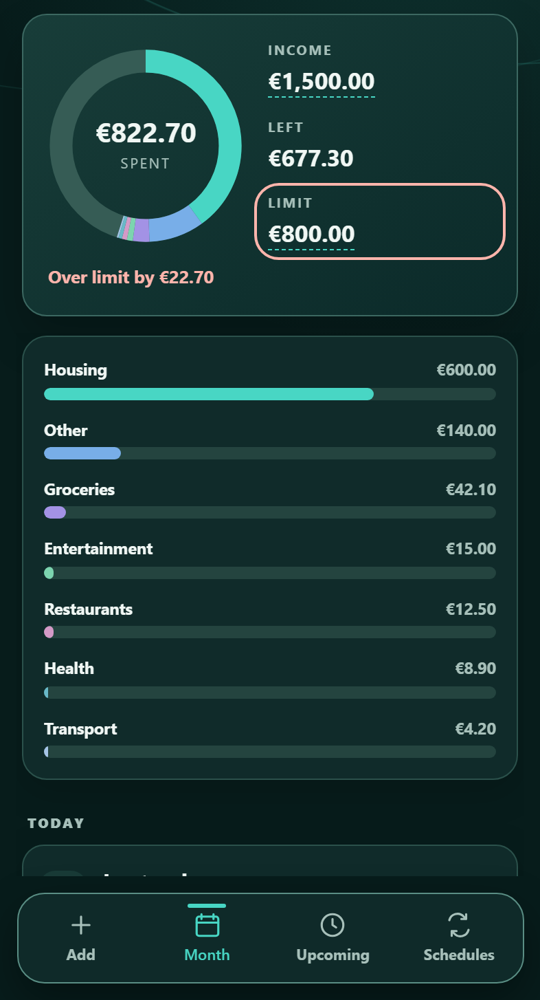
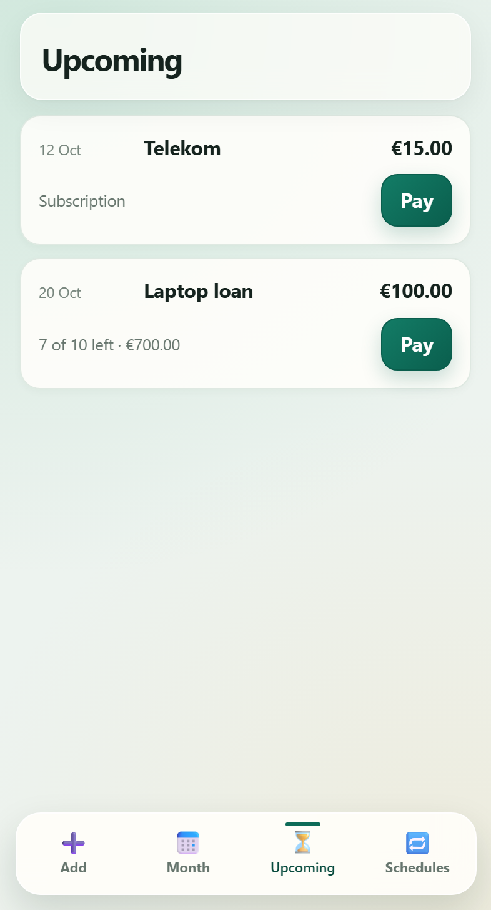
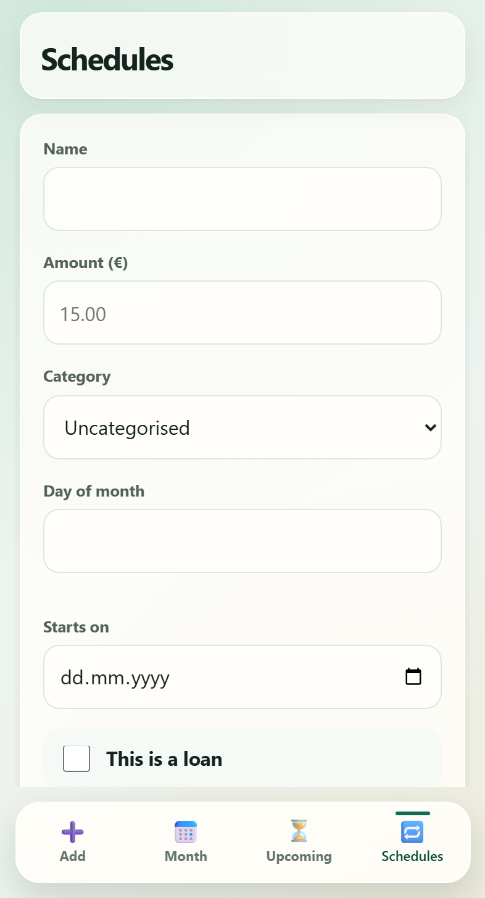

[English](../../README.md) · **Slovenčina**

Dokumentácia je dostupná v angličtine a slovenčine v jednom repozitári; aplikácia a jej rozhranie zostávajú v angličtine.

<div align="center">

# Wallet Tracker

**Zaznamenávajte výdavky v telefóne; pri každom dôležitom postupe si môžete pozrieť testy a správy o chybách.**

[](https://github.com/DaniilBehus/wallet-tracker/actions/workflows/ci.yml)
[](../../LICENSE)

[Analytické portfólio](#analyst-portfolio) · [Snímky](#screenshots) · [Kde začať](#start-here) · [Dôkazy QA](#qa-evidence) · [Rýchly štart](#quick-start)

</div>

<a id="analyst-portfolio"></a>
## Analytické portfólio

Preskúmajte, ako sa funkcia osobného projektu dostane od obchodného pravidla cez model a fungujúci kód až po dôkazy z testovania. Modely opisujú projekt; nie sú tvrdením o komerčnej skúsenosti ani dôkazom, že vlastník prijal výsledok.

<p align="center">
  <a href="docs/analysis/use-cases.svg"></a>
</p>

<p align="center"><strong>Možnosti produktu, nie mapa obrazoviek</strong> · <a href="docs/analysis/use-cases.svg">Otvoriť veľkú mapu</a> · <a href="docs/analysis/use-cases.md">Prečítať rozsah a zdroj formálneho modelu UML</a></p>

**Vyberte si model:**

- [Mapa limitu kategórie](docs/analysis/category-limit-process.md): nastavte alebo vymažte rozpočet; uloženie výdavku limit nikdy nezablokuje.
- [Mapa mesačného limitu](docs/analysis/monthly-limit-process.md): porovnajte skutočné výdavky s celkovým limitom.
- [Mapa zadania výdavku cez AI](docs/analysis/ai-expense-process.md): opísať → skontrolovať → výslovne uložiť, vrátane odmietnutia a zrušenia.
- [Mapa možností](docs/analysis/use-cases.md): čo môže používateľ urobiť a čo je mimo rozsahu.
- [Mapa návrhu a uloženia](docs/analysis/draft-save-sequence.md): zodpovednosti komponentov, opakovanie požiadavky s kľúčom a hranice transakcií.
- [Dátový model](docs/analysis/database.md): vzťahy, obmedzenia a stĺpec limitu kategórie.

Tieto SVG sú vysvetľujúce modulárne mapy. Každá analytická stránka odkazuje aj na zachovaný formálny BPMN, Mermaid alebo UML SVG a tam, kde existuje, na editovateľný model.

**Sledujte jednu funkciu: rozpočty kategórií**

1. [Obchodný cieľ a pravidlá](qa/docs/analysis-category-limits.md#1-business-goal-scope-and-assumptions) a [používateľské príbehy a akceptačné kritériá](qa/docs/analysis-category-limits.md#2-requirements-and-acceptance-criteria).
2. [Procesný model](docs/analysis/category-limit-process.md) → [dátový model](docs/analysis/database.md) → [API kategórií](../../src/routes/categories.js) a [výpočet súhrnu](../../src/routes/summary.js).
3. [Regresia v prehliadači](../../qa/e2e/category-limits.spec.js) → [sledovateľnosť požiadavka–test](qa/docs/analysis-category-limits.md#5-traceability) → [zaznamenané výsledky](qa/docs/test-report-category-limits.md).
4. [Vlastníkom hlásená akceptácia 13/13 krokov pre limity kategórií](qa/docs/uat-category-limits.md) na pomenovanom testovacom zostavení so syntetickými dátami; [záznam aktuálneho zostavenia](qa/docs/uat-current-build.md) ponecháva voliteľný test stratenej odpovede Save/Pay ako **NOT RUN**.

[Všetky modely, zdrojové súbory a datované dôkazy o publikovaní](docs/analysis/README.md) ·
[Kontrakt celého API a spustiteľné kontroly](docs/api/README.md) ·
[Kontroly prehliadača v Selenium a Pythone](qa/selenium/README.md)

<a id="screenshots"></a>
## Snímky obrazovky

<p align="center">
  <a href="../../docs/screenshots/1-add.png"></a>
  &nbsp;
  <a href="../../docs/screenshots/2-month.png"></a>
</p>

<p align="center"><strong>Pridanie výdavku</strong> · <strong>Kontrola mesiaca a jeho limitu</strong><br>Skutočné obrazovky aplikácie s demo údajmi</p>

Webová aplikácia na osobné financie pokrýva výdavky, mesačné limity, opakované platby a splátky úverov. Repozitár obsahuje návrh testov, automatizované kontroly, zaznamenané výsledky a vyšetrovania chýb.

<details>
<summary><strong>Ďalšie obrazovky: budúce platby a rozvrhy</strong></summary>

<p align="center">
  <a href="../../docs/screenshots/3-upcoming.png"></a>
  &nbsp;
  <a href="../../docs/screenshots/4-schedules.png"></a>
</p>

Predplatné sa opakuje; úver sa skončí po určenom počte splátok. Obe používajú ten istý model rozvrhu. Štyri snímky možno znovu vytvoriť príkazom `npm run screenshots`.

</details>

<a id="start-here"></a>
## Kde začať

- **Pozrieť aplikáciu:** [Snímky](#screenshots) → [Rozsah produktu](spec/architecture.md#1-product-and-scope)
- **Posúdiť analýzu:** [Analytické portfólio](#analyst-portfolio) → [modely a cesty k dôkazom](docs/analysis/README.md)
- **Spustiť ju:** [Rýchly štart](#quick-start) → [Nastavenie testov](docs/testing.md)
- **Podporovať ju:** [Podporný balík](docs/support/README.md) → [Prevádzková príručka](docs/support/runbook.md)
- **Posúdiť prácu QA:** [Dôkazy QA](#qa-evidence) → [Prípadová štúdia mesačného limitu](qa/docs/analysis-monthly-limit.md)
- **Pozrieť predbežný syntetický import:** [Rozsah a rozhodnutia vlastníka](qa/docs/analysis-synthetic-import.md) → [API trasy](../../src/routes/imports.js) → [offline regresia](../../qa/import/synthetic-import.test.js), [testovací demonštrátor HTTP na loopback](../../qa/import/provider-adapter.test.js) a [test kontroly v prehliadači](../../qa/e2e/synthetic-import.spec.js). Prehliadač ponúka iba pevný fiktívny záznam; netvrdíme, že existuje konektor poskytovateľa.
- **Čítať kód:** [Mapa priečinkov](#architecture) → [Poznámky k architektúre](spec/architecture.md)

Pre API otvorte [OpenAPI kontrakt, spustiteľné kontroly a zaznamenané pokrytie](docs/api/README.md).

<a id="qa-evidence"></a>
## Dôkazy QA

**Začnite [aktuálnym stavom QA](docs/qa-status.md) a [návrhom testov](qa/docs/test-design.md), prejdite si [testovacie prípady](qa/docs/test-cases.md), potom sledujte [chybu od reprodukcie po regresiu](../../qa/docs/defects).**

| Dôkaz | Otvoriť zdroj |
|---|---|
| Plán a návrh prípadov | [Testovací plán](qa/docs/test-plan.md) · [Metóda návrhu](qa/docs/test-design.md) · [Katalóg prípadov](qa/docs/test-cases.md) |
| API a databáza | [Kolekcia Postman](../../qa/api/wallet.postman_collection.json) · [Scenáre pytest](../../qa/python/test_api.py) · [Testy migrácie](../../qa/db/migration.test.js) · [Regresia syntetického importu](../../qa/import/synthetic-import.test.js) |
| Postupy v prehliadači | [Špecifikácie Playwright](../../qa/e2e) · [Objekty stránok](../../qa/e2e/pages) · [Kontroly Selenium + pytest](../../qa/selenium) |
| Prístupnosť | [Regresia v prehliadači](../../qa/a11y) · [Lokálne dôkazy a obmedzenia](qa/docs/accessibility-baseline.md) |
| Súbežnosť a záťaž | [Runner pre preteky](../../qa/race/run.js) · [Úlohy k6](../../qa/load) |
| Zaznamenané výsledky | [Správa o mesačnom limite](qa/docs/test-report-monthly-limit.md) · [GitHub CI](https://github.com/DaniilBehus/wallet-tracker/actions/workflows/ci.yml) |
| Hranice AI | [Prípadová štúdia AI](qa/docs/ai-case-study.md) · [limity vyhodnocovania](qa/docs/ai-evaluation.md) |

GitHub Actions spúšťa kontrolu tajomstiev, migrácie, API, Python, Playwright, Selenium a offline kontroly AI. Samokontrolný príkaz vynucuje osem brán invariantov a pokrytia. [Spustite sady a pozrite nastavenie →](docs/testing.md)

<a id="case-study-a-monthly-spending-limit"></a>
### Prípadová štúdia: mesačný limit výdavkov

Sledujte jednu funkciu od požiadaviek po akceptačné kontroly. Analýza obsahuje rozhodovaciu tabuľku, hranice, stavy, riziká, sledovateľnosť a dopad zmien.

**Sledujte dôkazy:** [požiadavka](qa/docs/analysis-monthly-limit.md#2-requirements-and-acceptance-criteria)
→ [rozhodovacia tabuľka](qa/docs/analysis-monthly-limit.md#3-decision-table--limit-state)
→ [testovacie prípady](qa/docs/test-cases.md#api--monthly-spending-limit--folder-12)
→ [zaznamenaný výsledok](qa/docs/test-report-monthly-limit.md#4-results--the-local-run-of-2026-09-23)
→ [zostávajúca hranica akceptácie](qa/docs/uat-monthly-limit.md#recorded-run--2026-09-23).

[Úplná analýza](qa/docs/analysis-monthly-limit.md) · [test prehliadača](../../qa/e2e/month.spec.js) · [test migrácie](../../qa/db/migration.test.js)

Správa rozlišuje zaznamenané lokálne výsledky od reprodukovateľných kontrol. Testy migrácie zahŕňajú opakovateľnú negatívnu kontrolu; UAT prebehla dvakrát na jednorazovej databáze — skúška agenta a potom vlastný prechod vlastníka všetkými jedenástimi krokmi na zostavení `3d4e9a7`, schválený 24. 9. 2026 bez defektov a s jedným zistením k prezentácii (UAT-OBS-01).

<a id="defects-worth-opening"></a>
### Chyby, ktoré sa oplatí otvoriť

| Zistenie | Vyšetrovanie |
|---|---|
| Neúspešné prihlásenia blokovali nesúvisiace požiadavky | [BUG-004: záťažový test a oprava bcrypt](qa/docs/defects/BUG-004-bcrypt-blocks-event-loop.md) |
| Súbežné zápisy vracali 500 | [BUG-012: preteky dvoch procesov nad SQLite](qa/docs/defects/BUG-012-deferred-transaction-500.md) |
| Nepodporovaná mena sa zmenila na návrh v EUR | [Vyšetrovanie negatívneho prípadu AI](qa/docs/ai-case-study.md) |

[Úplný register chýb: reprodukcia → príčina → oprava → regresná kontrola](log/BUGS.md)

<a id="quick-start"></a>
## Rýchly štart

**Vyžaduje stabilný Node.js `^22.14.0 || >=23.6.0` s Node-API 10+.** Nainštalovaná väzba SQLite potrebuje Node-API 10; staršie verzie 22.x a 23.0–23.5 sú odmietnuté pred načítaním natívneho modulu. Na bežné použitie zvoľte aktuálne opravené podporované vydanie LTS; presné pripnutie 22.14.0 v CI je kontrola minimálnej kompatibility, nie bezpečnostné odporúčanie. Naklonujte repozitár a nainštalujte uzamknuté závislosti:

```bash
git clone https://github.com/DaniilBehus/wallet-tracker.git
cd wallet-tracker
npm ci
```

Skopírujte `.env.example` do `.env` (`cp .env.example .env` v macOS/Linux,
`Copy-Item .env.example .env` v PowerShelli). `JWT_SECRET` nastavte na dlhú náhodnú hodnotu. Lokálne ju môžete vygenerovať takto:

```bash
node -e "console.log(require('node:crypto').randomBytes(48).toString('hex'))"
npm start
```

Otvorte **http://127.0.0.1:3000**. Bežná aplikácia sa výslovne viaže na IPv4 loopback, beží lokálne so SQLite a nepotrebuje kľúč AI. Ak chcete vedome počúvať v sieti LAN, nastavte `WALLET_HOST` výslovne (napríklad `WALLET_HOST=0.0.0.0 npm start` v POSIX shelli alebo `$env:WALLET_HOST='0.0.0.0'; npm start` v PowerShelli). Nenastavená alebo prázdna hodnota zostáva na loopbacku; všeobecná premenná `HOST` sa ignoruje. Širšie sieťové viazanie nie je dôkazom bezpečného nasadenia: zvlášť skontrolujte firewall, autentifikáciu a sieťovú dostupnosť.

Predpoklady testov API, Pythonu, prehliadača a záťaže sú v [návode na spustenie testov](docs/testing.md).

<a id="ai-expense-entry"></a>
## Zadanie výdavku cez AI

Opíšte jeden výdavok po anglicky, ukrajinsky alebo slovensky, skontrolujte navrhnuté polia a potom ho uložte. Server overuje sumu, dátum a kategóriu; opakovaný pokus o uloženie používa idempotentný kľúč. Bežná číselnica zostáva dostupná.

```bash
npm run ai:demo
```

Demo sa otvorí na **http://localhost:3100**, používa vlastnú databázu a prijíma sedem pevných príkladových viet. **Používa vzorové odpovede a nikdy nevolá službu AI.**

Vrstva AI má 237 offline testov, 25 scenárov v prehliadači na dvoch veľkostiach obrazovky a korpus 116 riadkov. Kontrolujú aplikáciu a vyhodnocovač; **kvalita skutočného modelu nebola meraná** (`MODEL_QUALITY=NOT_MEASURED`). Jeden offline test sa preskočí na hostiteľoch, kde symbolické odkazy na súbory vyžadujú ďalšie oprávnenia.

[Snímky a režimy](docs/ai-feature.md) · [Kontrakt funkcie](spec/ai-expense-entry.md) · [Metóda a hranice vyhodnocovania](qa/docs/ai-evaluation.md)

<a id="architecture"></a>
## Architektúra

**Node.js `^22.14.0 || >=23.6.0` (Node-API 10+) · Express · SQLite · JWT · bcrypt**
V prehliadači sa používa čisté HTML, CSS a JavaScript. Štyri behové závislosti, bez zostavovania frontendu.

| Rozhodnutie | Prečo je dôležité |
|---|---|
| Ukladať peniaze ako celé centy | Predchádzať chybám pohyblivej rádovej čiarky v súčtoch |
| Odvodené hodnoty vypočítať pri čítaní | Udržať ďalšiu platbu a zostatok úveru v zhode |
| Pre záznam iného používateľa vrátiť 404 | Nepotvrdiť existenciu cudzieho záznamu |

| Umiestnenie | Obsah |
|---|---|
| [`src/`](../../src) · [`public/`](../../public) | Express API, schéma SQLite a rozhranie prehliadača |
| [`qa/`](../../qa) | Testovacie sady, návrh testov, prípady a správy |
| [`spec/architecture.md`](spec/architecture.md) | Podrobné poznámky k architektúre a vývoju |
| [`docs/design-system.md`](docs/design-system.md) | Paleta rozhrania, pravidlá komponentov a vizuálne kontroly |
| [`log/BUGS.md`](log/BUGS.md) | Register chýb a dôkazy o regresii |
| [`scripts/`](../../scripts) | Samokontrolné brány a generátor snímok |

<a id="known-limits"></a>
## Známe obmedzenia

- Funkcia AI ešte nevyprodukovala výsledok zo skutočného modelu. Štítky korpusu vytvoril autor normalizéra a neboli nezávisle skontrolované.
- Pokrytie telefónov používa emulované veľkosti obrazovky. Neexistuje matica testov medzi rôznymi prehliadačmi.
- Aplikácia používa lokálne SQLite. Repozitár neobsahuje nastavenie nasadenia, Docker, penetračný test, sken zraniteľností závislostí ani offline synchronizáciu.
- Na obmedzených hostiteľoch môže Playwright potrebovať oprávnenie na spustenie Chromium. GitHub Actions je referenčné prostredie prehliadača.
- Toto je slovenská dokumentácia toho istého repozitára; bežiace používateľské rozhranie a spustiteľný kód zostávajú v pôvodnom jazyku. Snímky sú pôvodné dôkazy, nie preložené obrazovky.

---

Osobný projekt [Daniila Behusa](https://github.com/DaniilBehus) · [Licencia MIT](../../LICENSE)
