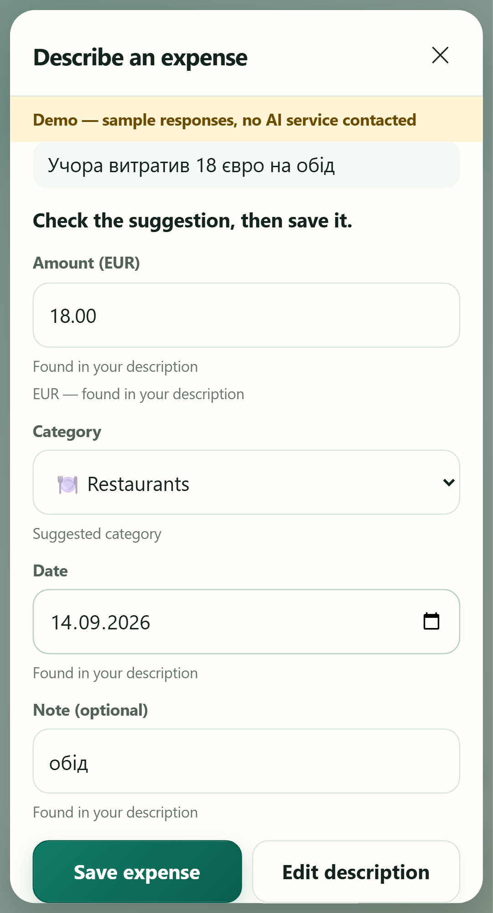
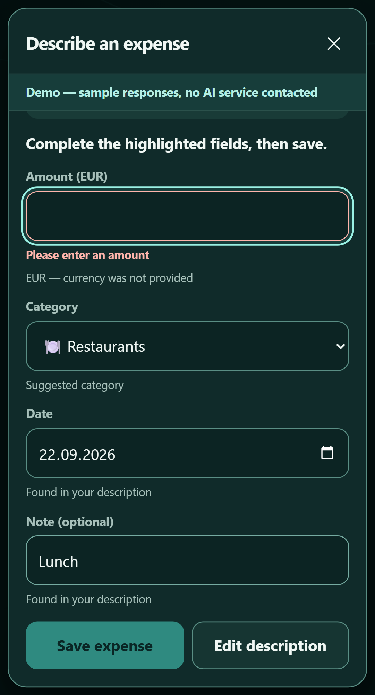

[English](../../../docs/ai-feature.md) · **Slovenčina**

<!-- locale-links-v1: source-relative links rebased for locales/sk -->

<a id="ai-expense-entry"></a>
# Zadanie výdavku s AI

[← Späť na README](../README.md#ai-expense-entry) · [Ďalej: prípadová štúdia AI →](../qa/docs/ai-case-study.md)

 

*Oba obrázky pochádzajú z demo režimu — vzorové odpovede, bez kontaktovania služby AI.*

Napíšte *"Учора витратив 18 євро на обід"* a Wallet vám vyplní formulár Add:
€18.00, Restaurants, včerajší dátum, "обід". Skontrolujete ho a stlačíte Save;
predtým sa nič neuloží. Podporovaná je angličtina, ukrajinčina a slovenčina;
iba eurá a jeden výdavok naraz. Číselná klávesnica sa nemení a zostáva
najrýchlejším spôsobom zadania.

S výstupom modelu sa zaobchádza ako s nedôveryhodným vstupom. Model môže iba
ukázať na text vo vašom opise a vybrať kategóriu z vášho vlastného zoznamu;
server sám vypočíta centy a dátum, odmietne čokoľvek, čo nie je doslovne
v texte, a nezávisle odmietne viditeľne nepodporovaný obsah — `10 USD` sa
nikdy nestane výdavkom v eurách bez ohľadu na tvrdenie modelu. Uloženia
z kontrolnej obrazovky nesú `Idempotency-Key`, takže opakovanie po strate
odpovede nemôže vytvoriť druhý výdavok. Kontrakt:
[`spec/ai-expense-entry.md`](../spec/ai-expense-entry.md).

**Skutočná AI je predvolene vypnutá.** Každý test AI, evaluácia aj demo
bežia offline: vopred sa načíta ochrana proti sieti, poskytovateľom je lokálny
falošný adaptér alebo pevná sada vzorových odpovedí a netreba žiadny kľúč.

```bash
npm run ai:demo        # http://localhost:3100 — fixed examples, no AI service, own database
```

| Režim | Ako | Čo sa stane |
|---|---|---|
| off | predvolene | žiadny vstupný bod; nikam sa nič neposiela |
| demo | `npm run ai:demo` | sedem pomenovaných vzorových viet; pri čomkoľvek inom aplikácia oznámi, že to v deme nie je |
| live | `WALLET_AI_MODE=live` + `OPENAI_API_KEY` + `WALLET_AI_MODEL` + `WALLET_AI_LIVE_ALLOWED=true` v lokálnom `.env` | opis a názvy vašich kategórií odídu do OpenAI po zaškrtnutí súhlasu; platia malé denné a minútové limity |

**Čo evaluácia ukazuje a čo nie.** `npm run eval:ai` spúšťa korpus
116 riadkov cez produkčnú službu s pripravenými odpoveďami. Tým kontroluje
normalizátor, ochranné kontroly a hodnotiacu funkciu — nie model
(`MODEL_QUALITY=NOT_MEASURED`). Samostatný, výslovne zapnutý evaluátor
živého modelu má vlastný konečný limit a okno 5 volaní za 10 minút;
netvrdí sa tu žiadny výsledok kvality skutočného modelu. Podrobnosti:
[`qa/docs/ai-evaluation.md`](../qa/docs/ai-evaluation.md).
