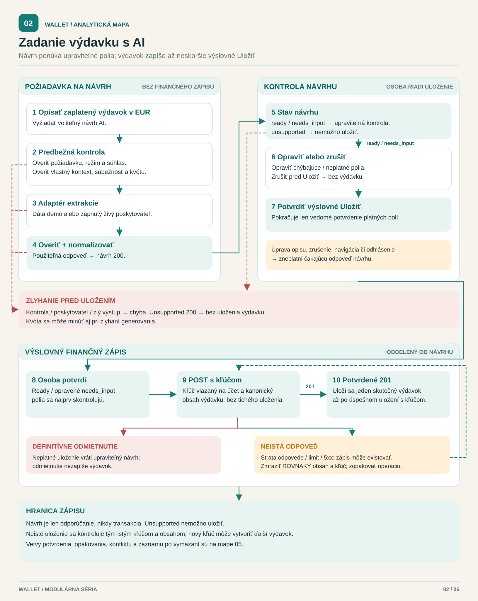

[English](../../../../docs/analysis/ai-expense-process.md) · **Slovenčina**

<!-- locale-links-v1: source-relative links rebased for locales/sk -->

# Zadanie výdavku s pomocou AI — modulárna mapa

[← Späť na README](../../README.md#start-here) · [Prehľad analýzy](README.md) · [Ďalej: sekvencia API →](draft-save-sequence.md)

**Otázka:** kde končí návrh a začína finančný zápis?

[Otvoriť modulárnu mapu](ai-expense-process.svg) · [Zachovaný formálny diagram BPMN](formal/ai-expense-process.svg) · [Upraviteľný zdroj BPMN 2.0](ai-expense-process.bpmn)

Modulárna mapa sumarizuje hranice; zachovaný formálny BPMN podrobne zobrazuje
účastníkov a vetvy. Účastník Wallet v BPMN modeluje akcie osoby v rozhraní
ako používateľské úlohy a prácu servera ako servisné úlohy. Poskytovateľ
extrakcie je účastníkom typu čierna skrinka: medzi účastníkmi prechádzajú
správy, nie sekvenčné toky. V režime demo ide o adaptér s pripravenými dátami,
nie o externú službu. Pri vypnutom/nedostupnom režime požiadavka zlyhá pred
extrakciou; bežné ručné zadanie zostáva dostupné.

- Validácia požiadavky, súhlas v živom režime, kontext vlastných kategórií,
  súbežnosť a kontrola kvóty prebehnú pred odoslaním. Odmietnutá požiadavka
  ani nepoužiteľný výsledok poskytovateľa nikdy nevložia výdavok; používateľ
  sa vráti k úpravám.
- Odpoveď má stav `ready`, `needs_input` alebo `unsupported`. Pri
  `needs_input` treba opraviť údaje; `unsupported` z danej odpovede uložiť
  nemožno.
- Kontrola návrhu je upraviteľná. Voľba Zrušiť skončí bez finančného zápisu.
  Úprava opisu vyžiada nový návrh. Čakajúce odpovede sa zneplatnia pri úprave,
  zrušení, navigácii alebo odhlásení.
- Zbalená aktivita **Výslovné uloženie s kľúčom** obsahuje výslovné Uložiť,
  potvrdenie 201, upraviteľné odmietnutie, odhlásenie pri 401, neistý výsledok,
  opakovanie s rovnakým kľúčom a výslovné upustenie. Pozri aj
  [sekvenčný model](draft-save-sequence.md). Jej koniec znamená koniec
  interakcie ukladania, **nie** úspech každého pokusu.

**Rozsah:** autentifikácia je predpokladom; chyby parsera/autentifikácie,
jednotlivé chybové kódy, ochrany generácie v rozhraní a zápisy kvóty sú
zoskupené do aktivít. Zrušenie je zobrazené pred Uložiť; počas ukladania alebo
pri neistom výsledku sa rozhranie samo ticho nezavrie. Upustenie od neistého
uloženia nezaručuje, že sa nič neuložilo. Nevyplýva z toho tvrdenie o kvalite
modelu.

## Reprodukcia náhľadu

[Prehľad](README.md#maintain-and-reproduce) uvádza samostatné príkazy:
vstavaný generátor Node kontroluje alebo zapisuje modulárnu mapu, kým formálny
exportér, ak sú dostupné jeho nástroje, parsuje `.bpmn` pomocou bpmn-moddle,
kontroluje hranice sekvenčných tokov a správ aj výlučné vetvy, importuje cez
bpmn-js, znovu uloží XML a exportuje zachovaný formálny SVG. Skontrolujte aj
kontrolný PNG pre kolízie čiar a štítkov: samotné kontroly ohraničujúcich
obdĺžnikov ich neodhalia. Proces nevykonáva a nedokazuje výsledky testov
aplikácie.

## Zdroje a pokrytie

| Pravidlo modelu | Autoritatívny zdroj a pokrytie |
|---|---|
| Návrh nie je transakcia; výslovná upraviteľná kontrola | [AI-R01–02](../../spec/ai-expense-entry.md#2-rules-acceptance-ids), [hranica zápisu služby](../../../../src/ai/service.js), [integračné testy HTTP](../../../../qa/ai/tests/integration.test.js) |
| Ochrany pred odoslaním, kontrola výstupu, tri stavy návrhu | [kontrakt §§4–6](../../spec/ai-expense-entry.md#4-endpoints-both-behind-requireauth), [služba](../../../../src/ai/service.js), [normalizátor](../../../../src/ai/normalize.js), [integračné pokrytie](../../../../qa/ai/tests/integration.test.js) |
| Zrušenie, zastaraná odpoveď a ovládanie Uložiť | [AI-R15–16](../../spec/ai-expense-entry.md#2-rules-acceptance-ids), [stavový automat rozhrania](../../../../public/ai-expense.js), [testy komponentov](../../../../qa/ai/tests/ui-state.test.js), [prehliadačové testy](../../../../qa/e2e/ai) |
| Uloženie s kľúčom je finančný zápis | [trasa transakcií](../../../../src/routes/transactions.js), [testy uloženia s kľúčom](../../../../qa/ai/tests/idempotency.test.js) |
