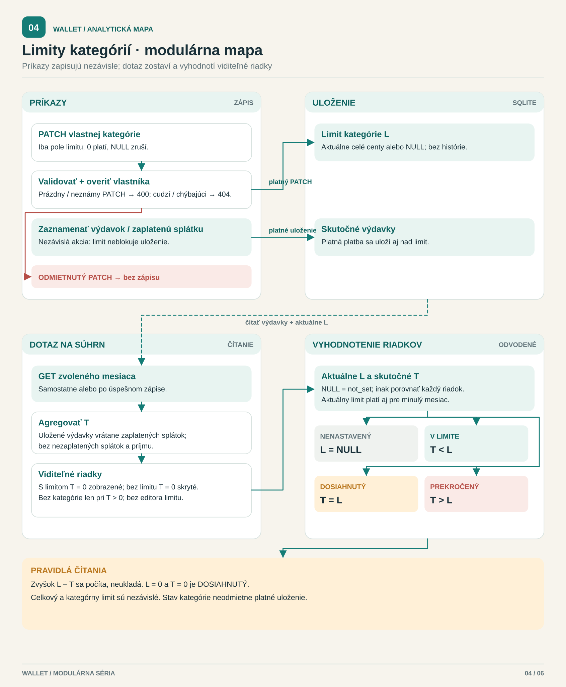

[English](../../../../docs/analysis/category-limit-process.md) · **Slovenčina**

<!-- locale-links-v1: source-relative links rebased for locales/sk -->

# Limity výdavkov podľa kategórie — modulárna mapa

[← Späť na README](../../README.md#start-here) · [Prehľad analýzy](README.md) · [Ďalej: dátový model →](database.md)

**Implementované a publikované; zaznamenané UAT 13/13 podľa vyjadrenia vlastníka.**
Formálny model bol zmrazený pred implementáciou v `4d08651`; pozri
[správu z lokálnych testov](../../qa/docs/test-report-category-limits.md).
Správanie existujúceho celkového limitu je zobrazené osobitne v
[modeli mesačného limitu](monthly-limit-process.md).

[Otvoriť modulárnu mapu](category-limit-process.svg) · [Zachovaný formálny diagram BPMN](formal/category-limit-process.svg) · [Upraviteľný zdroj BPMN 2.0](category-limit-process.bpmn)

## Postup krok za krokom

1. Prihlásená osoba nastaví alebo zruší limit kategórie, alebo zaznamená
   platný výdavok / zaplatenú splátku. Neplatný limit sa odmietne bez zápisu;
   chýbajúca kategória aj kategória iného účtu vrátia `404`.
2. Zápis limitu uloží jednu aktuálnu celočíselnú hodnotu vrátane `0` alebo
   ho výslovne zruší hodnotou `null`. Prázdny PATCH alebo PATCH s neznámym
   poľom je neplatný, nejde o zrušenie. Uloženie inak platného výdavku
   nikdy nekontroluje prekročenie rozpočtu.
3. Samostatné čítanie `GET /api/summary` agreguje skutočné výdavky za
   zvolený mesiac. Zaplatené splátky sú výdavky; nezaplatené splátky
   a príjmy nie. Kategórie s limitom sa zobrazia aj pri nulovej útrate.
   Kategórie bez limitu a bez útraty zostávajú skryté; Bez kategórie
   sa zobrazí iba vtedy, keď má útratu.
4. V zachovanom formálnom BPMN rozbalený podproces s viacerými inštanciami
   vyhodnotí každý zobrazený riadok. Bez kategórie a limit `NULL` dávajú
   `not_set`. Inak `T < L` znamená `within`, `T = L` je `reached`
   (aj keď sú obe hodnoty nulové) a `T > L` je `exceeded`. Zvyšok je `L - T`.
5. Prehliadač použije vrátený stav: biely obrys, kým zostáva rozpočet;
   plné červené pole s bielym textom pri dosiahnutí / prekročení.
   Slová tieto dva stavy rozlišujú; riadky bez limitu nemajú pole
   a Bez kategórie nemá editor.

## Rozsah a zjednodušenia

- V zachovanom formálnom BPMN plné šípky zostávajú v jednom účastníkovi
  a prerušované šípky označujú správy medzi účastníkmi. Modulárna mapa
  namiesto toho používa vysvetľujúce spojenia. Ani jeden diagram nie je
  vykonateľný procesný nástroj.
- Formálny diagram sleduje zápis a následné obnovenie rozpisu. Samostatné
  čítanie súhrnu použije rovnakú agregáciu a vyhodnotenie bez predchádzajúceho
  zápisu. Limit kategórie nikdy nemení celkový limit ani nevaliduje ich súčet.
- Osoba/prehliadač je účastník typu čierna skrinka. Autentifikácia je
  predpokladom; neplatný výdavok či pravidelná platba si zachovávajú svoje
  existujúce validačné a konfliktné správanie mimo tohto procesu.
  „Uložené bez ohľadu na limit“ znamená iba platné výdavky, nie ľubovoľné
  neplatné požiadavky.
- Aktuálne limity platia pre každý skúmaný mesiac; nepribúda história po
  mesiacoch, predpoveď, upozornenie, premenovanie/zmazanie kategórie
  ani automatická platba.
- Cyklus nad riadkami môže byť prázdny. Stav a zvyšok sa odvodzujú,
  nikdy sa neukladajú.

## Špecifikácia a lokálne dôkazy

- [CL-D1…CL-D12, požiadavky a rozhodovacia tabuľka](../../qa/docs/analysis-category-limits.md).
- [Architektúra: cieľový dátový model](../../spec/architecture.md#3-data-model-and-invariants),
  [API](../../spec/architecture.md#4-api-design) a
  [rozhranie](../../spec/architecture.md#5-interface-and-interaction-design).
- [Vyhodnocovacia funkcia](../../../../src/settings.js): opätovne použitá `limitState`,
  nie druhé porovnanie v prehliadači; [PATCH kategórie](../../../../src/routes/categories.js)
  a [mesačná agregácia](../../../../src/routes/summary.js).
- [Sledovateľnosť](../../qa/docs/analysis-category-limits.md#5-traceability) a
  [skutočné výsledky](../../qa/docs/test-report-category-limits.md) oddeľujú
  lokálnu automatizáciu od akceptácie vlastníka a GitHub CI.

[Datovaný dôkaz o publikovaní a CI](README.md#dated-publication-evidence--2026-09-29)
je oddelený od neskoršej [akceptácie 13/13 podľa vyjadrenia vlastníka](../../qa/docs/uat-category-limits.md).
