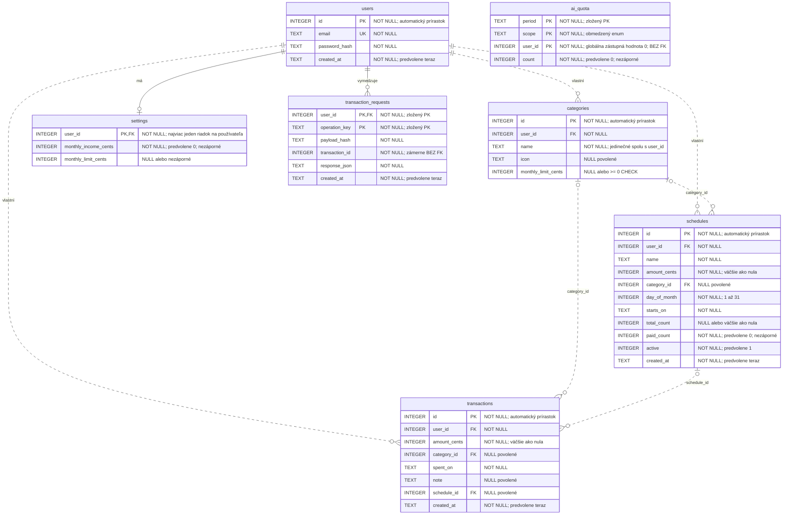

[English](../../../../docs/analysis/database.md) · **Slovenčina**

<!-- locale-links-v1: source-relative links rebased for locales/sk -->

# Databáza — modulárna dátová mapa a formálny ERD

[← Späť na README](../../README.md#start-here) · [Prehľad analýzy](README.md) · [Ďalej: ciele používateľa →](use-cases.md)

[Otvoriť modulárnu mapu](database.svg) · [Zachovaný formálny SVG ERD](formal/database.svg) · [Upraviteľný zdroj Mermaid](database.mmd)

Viditeľná modulárna mapa zoskupuje sedem tabuliek a osem deklarovaných
cudzích kľúčov; blok Mermaid a zachovaný formálny ERD ukazujú podrobnú notáciu.

**Implementované a publikované v [datovanom zostavení 2026-09-29](README.md#dated-publication-evidence--2026-09-29); neskôr bolo zaznamenané UAT vlastníka s obmedzeným rozsahom.**
Stĺpec kategórie bol zmrazený pred implementáciou v `4d08651`. Lokálna
schéma a chránená migrácia teraz v SQLite vynucujú
`CHECK (monthly_limit_cents IS NULL OR monthly_limit_cents >= 0)`,
nielen validátor API. Všetkých osem vzťahov cudzích kľúčov zostáva
nezmenených. Pozri [dôkaz o migrácii](../../qa/docs/test-report-category-limits.md)
a [CL-D12 / REQ-CL-13](../../qa/docs/analysis-category-limits.md#req-cl-13).
Pozri aj osobitný [datovaný záznam publikovania a CI](README.md#dated-publication-evidence--2026-09-29).

<!-- diagram-source: database.mmd -->

## Význam čiar

Všetkých osem zobrazených vzťahov sú deklarované cudzie kľúče SQLite.
`||` znamená presne jedného rodiča; `|o` znamená nula alebo jeden
(cudzí kľúč môže byť NULL); `o{` znamená nula až mnoho potomkov.
Plné vzťahy sú identifikačné (kľúč rodiča je súčasťou PK potomka);
bodkované sú neidentifikačné, **nie** nevynucované. Všetky cudzie
kľúče sa pri štarte zapínajú pomocou `PRAGMA foreign_keys = ON`.

Cudzie kľúče používateľa pri mazaní kaskádujú. Odkazy na kategóriu
a pravidelnú platbu používajú predvolené `NO ACTION`, nie `SET NULL`
ani kaskádu. Trasa momentálne poskytuje vytvorenie/zoznam kategórií,
nie ich mazanie; nullable odkazy neznamenajú, že rodičovské záznamy
možno ľubovoľne vymazať.

## Databázové obmedzenia a pravidlá aplikácie

| Vynucuje databáza | Aplikácia navyše vynucuje |
|---|---|
| Jedinečnosť e-mailu používateľa; jedinečnosť kategórie `(user_id, name)` | Autentifikovaný prístup obmedzený na používateľa; cudzie riadky skryté alebo odmietnuté |
| Kladné centy výdavku/pravidelnej platby; nezáporný príjem/limit | Celočíselné hodnoty a strop 100000000 centov pomocou validátorov |
| Existenciu cieľa cudzieho kľúča | Kategória patrí rovnakému používateľovi; jedno-stĺpcový FK to nedokáže potvrdiť |
| Kladný alebo nulový počet všetkých splátok; počet zaplatených ≥ 0; deň 1…31 | Celkový počet nesmie klesnúť pod už zaplatený; stav aktivity sa mení pri platbe/úprave |
| Dátumové stĺpce sú neprázdny TEXT | Platné lokálne kalendárne dátumy a rozsahy špecifické pre trasu (bez dátového typu SQL pre dátum) |
| Enum rozsahu kvóty a nezáporné počítadlo | Obdobia podľa času servera; limity používateľa a globálne limity; miesta súbežnosti v procese |

`transaction_requests.transaction_id` zámerne **nemá FK**: vymazanie výdavku
zachová záznam o uložení s kľúčom, aby neskoré opakovanie výdavok nevytvorilo
znova. Cudzí kľúč používateľa zostáva vynucovaný. `ai_quota.user_id` tiež
**nemá FK**, pretože `0` predstavuje globálne počítadlo. Ani jeden
preto nemá čiaru vzťahu k príslušnej tabuľke. Tabuľka opisu AI ani návrhov
neexistuje.

ERD obsahuje všetkých sedem aplikačných tabuliek a každý deklarovaný stĺpec
vrátane limitu kategórie; vnútorné účtovníctvo automatického prírastku SQLite
je vynechané. Indexy sú fyzické prístupové cesty, nie vzťahy:
`idx_tx_user_date (user_id, spent_on)` a `idx_sched_user (user_id, active)`.
Nový účet nemusí mať riadok nastavení; aplikácia vráti príjem 0 a limit
`NULL` bez jeho vytvorenia.

`next_due`, zostávajúce splátky/hodnota, mesačné súčty, zvyšok príjmu
a stav/zvyšok limitu sa počítajú pri čítaní. `paid_count` a `active`
**sú** uložené a aktualizujú sa v transakcii pravidelnej platby;
nenahrádzajte ich vymyslenou entitou histórie platieb. Primárne kľúče
SQLite INTEGER sú neprázdne identifikátory riadkov aj tam, kde schéma
výslovne neuvádza `NOT NULL`.

## Zdroje a pokrytie

- [Špecifikácia limitov kategórií](../../qa/docs/analysis-category-limits.md):
  aditívna migrácia, existujúce riadky zostávajú `NULL`, opakovaný štart
  je bezpečný, databázový CHECK je povinný. [Zaznamenané lokálne výsledky](../../qa/docs/test-report-category-limits.md)
  predchádzali [datovanému publikovaniu](README.md#dated-publication-evidence--2026-09-29);
  [akceptácia 13/13 podľa vyjadrenia vlastníka](../../qa/docs/uat-category-limits.md)
  bola zaznamenaná na neskoršom pomenovanom testovacom zostavení.
- [Úplná schéma](../../../../src/schema.sql) a [štart / aditívna migrácia limitu](../../../../src/db.js).
- [Validátory vlastníctva a hodnôt](../../../../src/validate.js),
  [zápisy pravidelných platieb a odvodené polia](../../../../src/routes/schedules.js),
  [zápisy transakcií s kľúčom](../../../../src/routes/transactions.js),
  [rezervácie kvóty](../../../../src/ai/limits.js).
- [Predvolené hodnoty pri čítaní / stav limitu](../../../../src/settings.js)
  a [mesačná agregácia](../../../../src/routes/summary.js).
- [Migrácia TC-DB-001–006](../../../../qa/db/migration.test.js),
  [regresia uloženia s kľúčom](../../../../qa/ai/tests/idempotency.test.js),
  [bezpečnostné prehliadačové testy](../../../../qa/e2e/security.spec.js)
  a [prípady API](../../qa/docs/test-cases.md).
