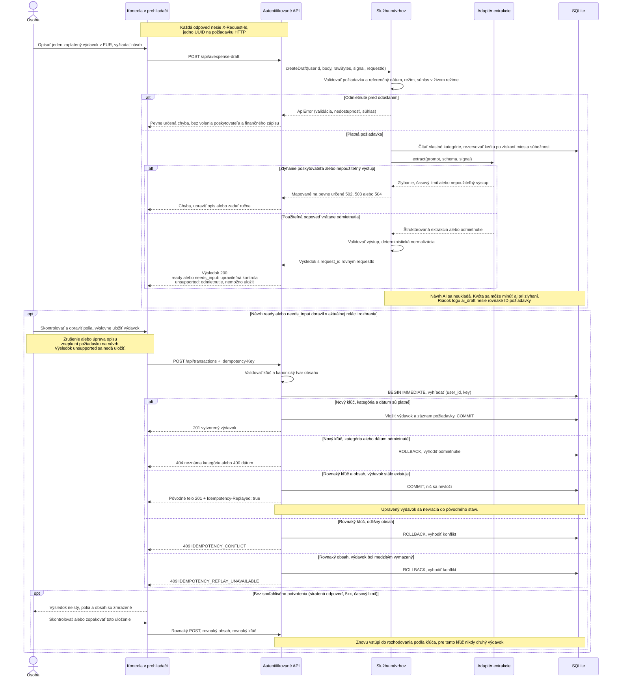

[English](../../../../docs/analysis/draft-save-sequence.md) · **Slovenčina**

<!-- locale-links-v1: source-relative links rebased for locales/sk -->

# Návrh a následné výslovné uloženie — modulárna mapa a sekvencia

[← Späť na README](../../README.md#start-here) · [Prehľad analýzy](README.md) · [Ďalej: dátový model →](database.md)

[Otvoriť modulárnu mapu](draft-save-sequence.svg) · [Zachovaný formálny sekvenčný SVG](formal/draft-save-sequence.svg) · [Upraviteľný zdroj Mermaid](draft-save-sequence.mmd)

Viditeľný SVG zoskupuje tvorbu návrhu, ľudskú kontrolu a trvalé uloženie
s kľúčom. Blok Mermaid nižšie a zachovaný formálny SVG ukazujú podrobnú
sekvenciu; šípky modulárnej mapy vysvetľujú, nepoužívajú notáciu Mermaid.

<!-- diagram-source: draft-save-sequence.mmd -->

**Zjednodušenia:** parsovanie JSON a autentifikácia sú zoskupené v API.
Úplné poradie spracovania HTTP a chybové kódy zostávajú v
[kontrakte §4](../../spec/ai-expense-entry.md#43-status-precedence-and-errors).
Zlyhania kontextu/kvóty sa spracujú ako ostatné chyby pred volaním
poskytovateľa; miesta pre súbežné požiadavky sa uvoľnia v `finally`.
Adaptér extrakcie znamená OpenAI v zapnutom živom režime alebo lokálne
pripravené dáta v demo režime, nie Gemini v aplikácii. Zrušenie môže prerušiť
čakanie, ale nezaručuje, že vzdialená práca vôbec nezačala.

Uloženie s kľúčom prebieha v jednej transakcii better-sqlite3 otvorenej
pomocou `BEGIN IMMEDIATE`: vetva s návratom ju potvrdí — nový výdavok alebo
opakovanie bez vloženia — a vetva, ktorá vyhodí chybu, ju vráti späť —
odmietnutá kategória či dátum a oba konflikty. Žiadny výsledok preto
nenechá zámok na zápis držaný. Kľúč alebo obsah nesprávneho tvaru sa odmietnu
kódom 400 ešte pred otvorením transakcie. Definitívne odmietnutie vráti
používateľa k upraviteľnej kontrole. Neistý výsledok zmrazí presnú operáciu;
upustenie od nej znamená, že človek musí overiť obrazovku mesiaca, nie že
nastal rollback. Nový vedomý nákup používa iný kľúč a môže vytvoriť druhý
rovnaký výdavok.

**ID požiadavky:** každá odpoveď nesie `X-Request-Id`. Služba návrhov
dostane rovnaké ID, vráti ho ako `request_id` a zapíše na riadok logu
`ai_draft`, takže podpora nájde návrh podľa ID z odpovede
([návod](../support/runbook.md#3-find-one-request-by-its-reference)).
Hlavné obrazovky pri chybe zobrazia prvých osem znakov ako *Referenciu*;
kontrola návrhu AI ich nezobrazuje.

## Zdroje a pokrytie

| Hranica | Autoritatívny zdroj / regresné pokrytie |
|---|---|
| AI-R01–02, 14, 18: oddelenie návrhu a zlyhania | [trasa AI](../../../../src/routes/ai.js), [služba návrhov](../../../../src/ai/service.js), [limity](../../../../src/ai/limits.js), [kontrakt](../../spec/ai-expense-entry.md), [testy HTTP](../../../../qa/ai/tests/integration.test.js) |
| AI-R15–16: zastaraná odpoveď, neisté uloženie a zmrazené opakovanie | [rozhranie](../../../../public/ai-expense.js), [testy stavu komponentu](../../../../qa/ai/tests/ui-state.test.js), [prehliadačová sada](../../../../qa/e2e/ai) |
| AI-R16–17: opakovanie, konflikt, záznam po vymazaní, zachovanie úprav | [trasa s kľúčom](../../../../src/routes/transactions.js), [kontrakt §8](../../spec/ai-expense-entry.md#8-keyed-save-d-035), [HTTP testy uloženia s kľúčom](../../../../qa/ai/tests/idempotency.test.js) |
| ID v každej odpovedi, znovu použité pri návrhu | [log požiadaviek](../../../../src/requestlog.js), [trasa AI](../../../../src/routes/ai.js), [služba návrhov](../../../../src/ai/service.js), [TC-PY-007, TC-PY-012](../../../../qa/python/test_request_log.py) |

**Poznámka k čítaniu zdroja:** úvodný komentár v `idempotency.test.js`
uvádza AI-R09, ale AI-R09 sa týka dátumov; jeho skutočné tvrdenia o opakovaní
pokrývajú AI-R16–17. Model sa riadi kontraktom a tvrdeniami testov.
Tento dokumentačný balík nemení žiadny normatívny súbor ani test.
