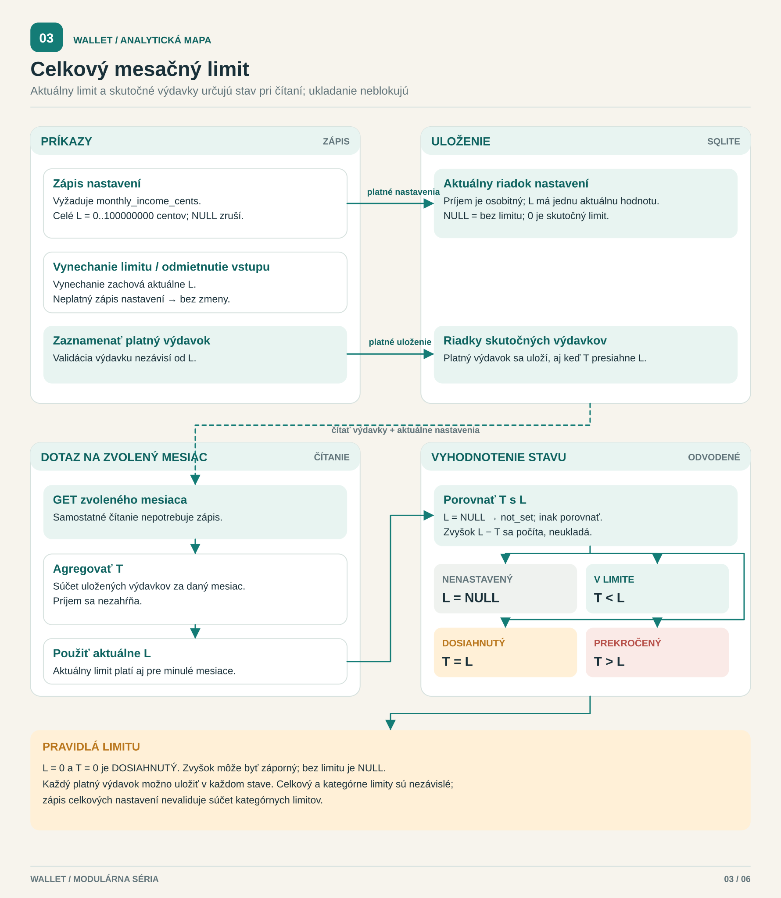

[English](../../../../docs/analysis/monthly-limit-process.md) · **Slovenčina**

<!-- locale-links-v1: source-relative links rebased for locales/sk -->

# Celkový mesačný limit výdavkov — modulárna mapa

[← Späť na README](../../README.md#start-here) · [Prehľad analýzy](README.md) · [Ďalej: dátový model →](database.md)

**Otázka:** ako aktuálny limit zmení zobrazený stav bez blokovania záznamov?

[Otvoriť modulárnu mapu](monthly-limit-process.svg) · [Zachovaný formálny diagram BPMN](formal/monthly-limit-process.svg) · [Upraviteľný zdroj BPMN 2.0](monthly-limit-process.bpmn)

Modulárna mapa oddeľuje zápis, trvalé uloženie a vyhodnotenie pri čítaní;
zachovaný formálny BPMN modeluje jednu reprezentatívnu interakciu prihlásenej
osoby: nastaviť/zrušiť limit alebo zaznamenať výdavok a potom vyžiadať súhrn
zvoleného mesiaca. Účastník používateľ typu čierna skrinka odošle požiadavku
a dostane výsledok; sekvenčné toky zostávajú vo Wallet. Prehliadač je
zoskupený so systémom, aby boli pravidlá jasné.

- Nastavte `L` ako celé číslo `0…100000000` centov; zrušte ho pomocou
  `NULL`. Zápis nastavení tiež vyžaduje `monthly_income_cents`. Vynechanie
  limitu zachová jeho hodnotu; nejde o zrušenie (REQ-ML-01–03).
- Neplatný vstup vráti chybu a daná akcia nič nezapíše (REQ-ML-07).
  Validácia výdavku je nezávislá od `L`: výdavok nad limitom stále vracia
  201 (REQ-ML-06).
- Pri `GET /api/summary?month=YYYY-MM` je `T` súčet výdavkov daného
  používateľa v požadovanom mesiaci, bez príjmu. Porovnajte **jeden aktuálny**
  `L` s `T`: `NULL → not_set`; `T < L → within`; `T = L → reached`;
  `T > L → exceeded`.
- Pri `L = 0, T = 0` je stav **reached**, nie not_set. Zvyšok limitu je
  `L − T` (môže byť záporný), prípadne `NULL` pri nenastavenom limite.
  Stav a súčty sa počítajú pri čítaní, neukladajú sa.
- Rozhranie zobrazuje aj slová, nielen farbu: V limite / Limit dosiahnutý /
  Nad limitom. Bez limitu ponúkne jeho nastavenie a riadok stavu vynechá.

**Rozsah:** jedna reprezentatívna interakcia, nie povinná sekvencia nastavenia
limitu pred každým výdavkom. Zápisy samotného príjmu sú zoskupené s vetvou
číselného/vynechaného nastavenia. Samostatné čítanie súhrnu, úpravy/mazanie
a prechod do iného mesiaca znovu vyhodnotia rovnaké pravidlo, ale tu nemajú
samostatné vetvy. Autentifikácia a chyby prenosu sú vynechané.
Diagram je opisný, nie vykonateľný pracovný postup API.

## Zdroje a pokrytie

| Pravidlo modelu | Autoritatívny zdroj a pokrytie |
|---|---|
| Nastavenie / zrušenie / vynechanie; validácia | [REQ-ML-01–03, 07](../../qa/docs/analysis-monthly-limit.md#2-requirements-and-acceptance-criteria), [trasa nastavení](../../../../src/routes/settings.js), [validátory](../../../../src/validate.js), [TC-API-091–093, 102–103](../../qa/docs/test-cases.md#api--monthly-spending-limit--folder-12) |
| Štyri stavy, nula a rovnosť; bez blokovania | [rozhodovacia tabuľka R1–R8](../../qa/docs/analysis-monthly-limit.md#3-decision-table--limit-state), [limitState](../../../../src/settings.js), [trasa súhrnu](../../../../src/routes/summary.js), [TC-API-094–101](../../qa/docs/test-cases.md#api--monthly-spending-limit--folder-12) |
| Text na obrazovke a priebežná aktualizácia | [TC-E2E-065–069](../../../../qa/e2e/month.spec.js), [rozhranie mesiaca](../../../../public/app.js), [zaznamenaná správa](../../qa/docs/test-report-monthly-limit.md) |
| Existujúca databáza zachováva význam „bez limitu“ | [aditívna migrácia](../../../../src/db.js), [TC-DB-001–003](../../../../qa/db/migration.test.js) |
